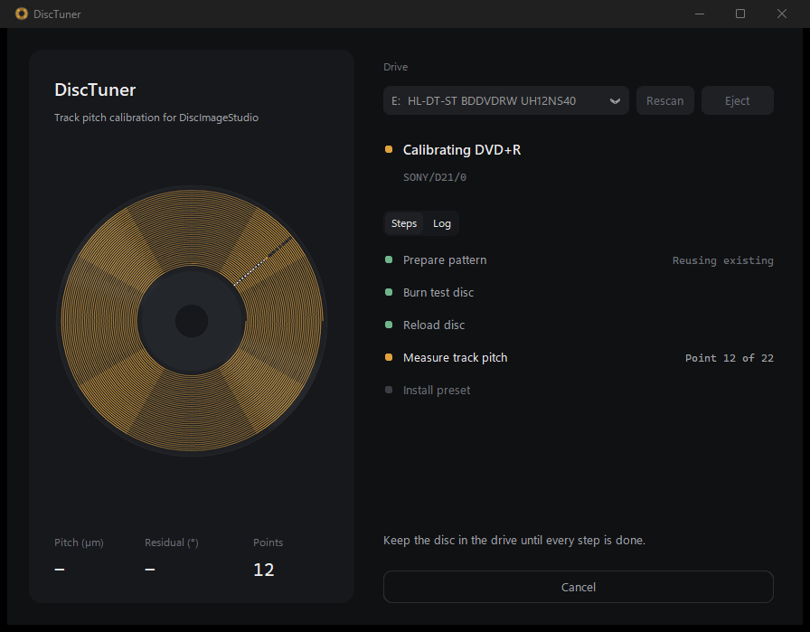

# DiscTuner

Calibrate a blank disc for [DiscImageStudio](https://github.com/JiaFeiMiao-K-Cat/DiscImageStudio) with one click and one disc.

DiscTuner drives [disc-probe](https://github.com/Ashley-QwQ/disc-probe). It burns disc-probe's random-data test pattern, reloads the disc, measures the spiral through the drive's read timing, fits the geometry, and writes the result as a preset into DiscImageStudio's preset list. The test disc is used up; burn your pictures on the next discs from the same batch.



*The window while measuring. The amber track is the burned part of the disc; the dots along one radius are the measurement points.*

DiscTuner is not affiliated with disc-probe or DiscImageStudio. It only automates their documented workflow.

## Supported discs

| Disc | Handling |
| --- | --- |
| CD-R, DVD-R, DVD+R, BD-R | Calibrated directly |
| CD-RW, DVD-RW, DVD+RW, BD-RE | Erased first, after you confirm, then calibrated |
| Dual layer, ROM, RAM | Refused, with the reason shown |

Caveats, also shown in the app:

- **CD:** timing leaves one constant unmeasured. Fine-calibrate the CD preset once in DiscImageStudio with a second blank.
- **Blu-ray:** experimental. The inner radius is measured; the pitch is nominal. The 25 GB test pattern is deleted after the burn.
- **BD-RE** can't be erased through Windows. Use a blank BD-R, or erase it elsewhere first.

## Will it work with my drive?

Not guaranteed. The measurement reads sector timing, so the drive has to cooperate:

- It must be burnable through Windows' IMAPI2 and answer disc-probe's low-level commands.
- It must hold a constant rotation speed at some read speed. DiscTuner tries several speeds and moves on when disc-probe reports the drive turned at constant linear speed instead. A drive that never holds constant rotation fails with a clear message, after the burn.
- Check disc-probe's list of [drives with reports](https://github.com/Ashley-QwQ/disc-probe#drives-with-hands-on-reports) before spending a disc.

Tested on real hardware: one HL-DT-ST BDDVDRW UH12NS40 with a CD-R (measure and install steps) and DVD+R results from disc-probe on the same drive. Burning, erasing and Blu-ray from inside the app are covered by tests against a fake disc-probe, not by real discs. Reports are welcome.

## Install

You need Windows 10 or 11 and these:

| What | Where | Notes |
| --- | --- | --- |
| Python 3.11 or newer | https://www.python.org/downloads/ | Tick "Add python.exe to PATH" when installing. |
| Git | https://git-scm.com/download/win | `setup.bat` uses it to fetch disc-probe. Optional if you extract disc-probe's ZIP yourself. |
| DiscImageStudio | https://github.com/JiaFeiMiao-K-Cat/DiscImageStudio/releases/latest | The program DiscTuner installs its presets into. |
| A burner | see [Will it work with my drive?](#will-it-work-with-my-drive) | |

Get DiscTuner in either of two ways:

1. Download `DiscTuner-v2.2.0.zip` from the [latest release](https://github.com/Fireball122/DiscTuner/releases/latest) and unzip it.
2. Or clone it: `git clone https://github.com/Fireball122/DiscTuner`

Then, in the DiscTuner folder, double-click `setup.bat`. When it finishes, double-click `run_disctuner.bat`.

`setup.bat` checks the Python version, installs the packages DiscTuner needs (disc-probe uses the same ones), clones disc-probe into the folder next to DiscTuner, runs disc-probe's self-test, and says whether DiscImageStudio is installed. It is safe to run again. `run_disctuner.bat` starts DiscTuner without a console window.

To do it by hand instead:

```
python -m pip install -r requirements.txt
git clone https://github.com/Ashley-QwQ/disc-probe ../disc-probe
python -m disctuner
```

DiscTuner looks for disc-probe next to its own folder, in `Downloads`, `Documents` and your home folder, and in `DISCTUNER_DISCPROBE`. If it finds nothing, the app offers a **Locate disc-probe** button and remembers your choice. DiscImageStudio is found the same way (`DISCTUNER_DIS_EXE`, `Downloads`, `%LOCALAPPDATA%\Programs\DiscImageStudio`) and asked for once if missing.

## Use

1. Put one blank disc from the spindle in the drive.
2. Press **Calibrate**. Don't touch the tray until it finishes.
3. Open the project DiscTuner saved: in DiscImageStudio choose **File > Open** and pick `Documents\DiscImageStudio Projects\<disc> (<manufacturer code>, Calibrated).discproj`. Colons in the name become underscores in the file name. Then add your image.

Calibrate once per spindle or batch. Running it again for the same disc type replaces that preset and project file. DiscImageStudio's previous preset file is backed up first by disc-probe. Every calibration, CD, DVD and Blu-ray, writes a project.

Burning writes a disc that can't be rewritten, and erasing wipes a rewritable one. DiscTuner asks before erasing and warns before you cancel mid-burn. You use it at your own risk.

## Troubleshooting

- **"The measurement stopped: the drive is not turning at a constant speed"** on every speed: the drive doesn't hold constant rotation for this disc type. Run `python -m discprobe timing --media <cd|dvd|bd> --drive E:` for details.
- **"The burned disc did not come back"**: push the tray in, wait, then measure by hand with `python -m discprobe geo --drive E:`.
- The **Log** tab shows everything disc-probe printed. Crashes are written to `%LOCALAPPDATA%\DiscTuner\crash.log`.

## Development

```
python -m pip install -r requirements.txt ruff
python -m ruff check .
python -m unittest discover -s tests
```

The pipeline tests run against a fake disc-probe, so they need no drive.

| Module | Role |
| --- | --- |
| `disctuner/calibration.py` | The pipeline: erase, pattern, burn, reload, measure, install. Emits progress events; no UI. |
| `disctuner/project.py` | Writes the DiscImageStudio project for a calibration, copying the installed preset's geometry. |
| `disctuner/media.py` | Supported disc types and per-family settings. |
| `disctuner/disc.py` | Reads and parses `discprobe info` into a `DiscInfo`. |
| `disctuner/drives.py` | Drive list, eject, close tray. |
| `disctuner/procs.py` | Hidden-window subprocesses with streamed output and cancellation. |
| `disctuner/paths.py` | Locating disc-probe and DiscImageStudio; saved settings. |
| `disctuner/ui/` | Window, theme, and the disc drawing. |
| `disctuner/scripts/erase_disc.ps1` | Quick erase through IMAPI2. |

## License

MIT, see [LICENSE](LICENSE). disc-probe is GPL-3.0-or-later and is run as a separate program; it is not bundled here.
